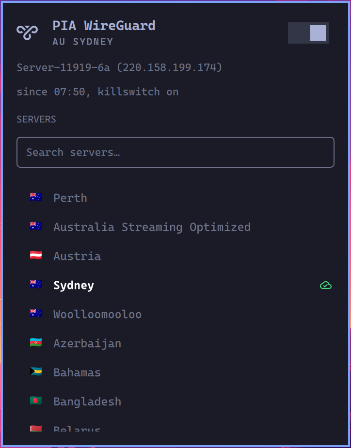

# PIA WireGuard for Omarchy and Linux

PIA (Private Internet Access) over WireGuard on Linux with NetworkManager and
systemd: a fresh key on every connect, a killswitch that holds from boot, a
watchdog that reconnects, and a one-command toggle. Includes a bar widget for
Omarchy and a waybar module for everyone else.

Written for Arch / Omarchy (Hyprland, ufw, Docker, libvirt all fine alongside
it); any distribution with NetworkManager, systemd 250+ and nftables should
work.

Unofficial: not affiliated with or endorsed by Private Internet Access. You
need your own PIA subscription.

<p align="center">
  
</p>
<p align="center"><sub>The Omarchy bar widget's panel: region, server, how long it has been up, the
on/off switch, and a searchable server list. Click a server to switch.</sub></p>

## Is this your problem?

- You imported a PIA WireGuard `.conf` into NetworkManager (`nmcli connection
  import type wireguard`). It worked, then a day later it "connects" but
  nothing loads.
- `sudo wg show` says `0 B received` and there is no `latest handshake` line.
- The VPN comes up at boot and kills your internet.
- PIA's official app misbehaves on Wayland / Hyprland / Omarchy.
- You want a real killswitch on Linux, like Android's "Block connections
  without VPN", without breaking ufw, Docker or libvirt.

Then this is for you.

## How this differs from other PIA widgets

Other PIA widgets for Omarchy are front ends for PIA's official desktop client
(`piavpn-bin` and its `piactl` command). This one does not use that client at
all: no proprietary daemon or GUI. It talks to PIA's API itself (the same calls
as PIA's open-source manual-connections scripts), runs the tunnel through
NetworkManager, and brings its own nftables killswitch and watchdog. Pick it if
the official client misbehaves on your desktop or you would rather not run
closed-source software as root. If you already run the official client happily,
a `piactl` widget is the simpler choice.

## Why it happens

PIA does not hand out permanent WireGuard configs: a registered key is
forgotten after a while, and a once-imported config then stops handshaking
(it "connects" but no traffic passes). `pia-nm` registers a fresh key on every
connect, so that never happens.

## What is in it

| File | What it does |
|---|---|
| `pia-nm` | Logs in to PIA, registers a fresh key, rebuilds the NetworkManager profile `pia` and connects; `--check` reconnects a dead or stale tunnel |
| `pia-killswitch` | An nftables table of its own: nothing leaves except through the tunnel, to the LAN, or, while connecting, to PIA's API (root only) and the network's DNS servers (two minutes). IPv6 is blocked (the tunnel is IPv4 only). ufw, Docker and libvirt rules are untouched |
| `ca.rsa.4096.crt` | PIA's CA certificate (the same file as in PIA's own OpenVPN bundle), which signs the key API. Installed to `/etc/pia`, checked by hash on every connect, never downloaded |
| `pia-vpn.service` | Runs `pia-nm connect`; a failed connect leaves the killswitch on and retries |
| `pia-killswitch.service` | Loads the killswitch before the network comes up |
| `pia-region@.service` | Saves a region and reconnects; the only root step behind switching server without a password |
| `pia-watchdog.timer` | Every minute: reconnects with a new key if the tunnel is down, stale or passes no traffic |
| `pia-toggle` | VPN + killswitch on/off together, no password (polkit rule `50-pia.rules`); `--status` prints JSON for a bar |
| `THIRD-PARTY-NOTICES.md` | Licence notice for the code adapted from Omawire |
| `manifest.json`, `Panel.qml`, `Fuzzy.js` | Omarchy bar widget `jamesrblack.pia`: status, server list with search and flags, click to toggle. At the top level so `omarchy plugin add` can install straight from this repo |

[docs/HOW-IT-WAS-BUILT.md](docs/HOW-IT-WAS-BUILT.md) records every problem hit
on the way (expiring keys, the killswitch design, a half-finished installer,
a watchdog that missed a dead tunnel, a polkit rule that refused "off") and how
each was found and fixed.

Credentials are encrypted with `systemd-creds` (bound to this machine and its
TPM when there is one) and decrypted only for `pia-vpn` and the watchdog. The
password and PIA's login token reach `curl` on stdin, never as arguments,
which every local user could read with `ps`.

## Install

Requirements:

- **NetworkManager managing your network** (running, not just installed). The
  tunnel is a NetworkManager connection. Setups that use iwd or
  systemd-networkd on their own need to switch first.
- **systemd 250 or newer**, for the encrypted credentials.
- `curl jq wireguard-tools nftables` and `column` (util-linux). On Arch:
  `sudo pacman -S --needed curl jq wireguard-tools networkmanager nftables`.
- A PIA subscription.

`install.sh` checks all of this first and changes nothing if anything is
missing; it prints the install command for your package manager (pacman, apt
or dnf). Do not enable `nftables.service`: its default config flushes ufw's
and Docker's rules.

```sh
git clone https://github.com/JamesRBlack/pia-wireguard-omarchy.git
cd pia-wireguard-omarchy
./install.sh                    # PIA login (once), region, detects your LAN
./install.sh --credentials      # change the saved login later
```

The installer records the network you are on as the LAN that stays reachable
with the killswitch on (`LAN=` in `/etc/pia/pia.env`; quote several:
`LAN="192.168.50.0/24, 10.20.0.0/16"`). It does not turn the VPN on or enable
it at boot.

### Bar: Omarchy (Quattro and later)

After `./install.sh`. The widget only displays and drives what the installer
sets up, so installing the widget alone (for example from the Omarchy plugin
marketplace) shows a "not installed" message until `./install.sh` has run,
and picks the system part up by itself once it has.

```sh
omarchy plugin add https://github.com/JamesRBlack/pia-wireguard-omarchy.git --enable
omarchy-restart-shell
```

Updates later: `omarchy plugin update jamesrblack.pia`.

If the icon ever disappears, for example after restoring or resetting the
bar, the plugin is still installed but disabled. Turn it back on:

```sh
omarchy plugin enable jamesrblack.pia right
omarchy-restart-shell
```

Omarchy Quattro has no waybar: `omarchy-restart-shell` is the way to restart
the bar.

Left click opens the panel: region, server, the on/off switch and a server
list with country flags and fuzzy search: type `lon`, `uk lon` or `uklon`,
then Enter (or click). The current server is in bold white, the rest grey. Flags
need a colour-emoji font (`noto-fonts-emoji` on Arch). Right click toggles,
middle click refreshes. The icon is red while traffic is blocked, and also
when something is wrong (a killswitch that failed to load, or a tunnel left up
without the service). It toggles quietly; failures still notify.

The server list comes from PIA's live server list: it is refreshed on every
connect and region switch, and by the watchdog when it is more than 6 hours old,
so regions PIA adds or retires show up without reinstalling anything.

### Bar: waybar

`pia-toggle --status` prints waybar's JSON. In `~/.config/waybar/config.jsonc`
add `"custom/pia"` to a modules list and:

```jsonc
"custom/pia": {
  "exec": "pia-toggle --status",
  "return-type": "json",
  "interval": 10,
  "signal": 9,
  "on-click": "pia-toggle --quiet",
  "on-click-right": "pia-toggle pick"
}
```

Classes `on`, `blocked`, `error` and `off` are there for `style.css`, e.g.
`#custom-pia.blocked, #custom-pia.error { color: #e06c75; }`.

### Keybinding (Hyprland)

```
bindd = SUPER ALT, V, Toggle PIA VPN, exec, pia-toggle
```

## Use

```sh
pia-toggle              # on <-> off
pia-toggle on | off
pia-toggle --status
```

Start at boot, with the killswitch up before the network:

```sh
sudo systemctl enable pia-killswitch pia-vpn
```

## Change server

No password needed; the killswitch stays up across the switch, and switching
while off connects.

- Omarchy: search or click a server in the widget's panel.
- Anywhere: `pia-toggle pick` opens a searchable menu (walker, fuzzel, wofi
  or rofi, whichever is installed). Bind it to a key or a bar right-click.
- Terminal: `pia-toggle --regions` lists ids, `pia-toggle region uk_london`
  switches.

Behind it, `pia-region@<id>.service` (root, allowed by the polkit rule) checks
the id against PIA's server list, saves it as `REGION=` in
`/etc/pia/pia.env` and restarts `pia-vpn`.

`PIHOLE=1` keeps your LAN DNS (e.g. a Pi-hole) instead of PIA's while
connected; queries then leave through your normal connection unless that DNS
server encrypts its upstream.
`KS_FORWARD=0` leaves VMs and containers out of the killswitch. It covers
NAT'd VM and container networks (libvirt's default, Docker, Podman); a VM
bridged straight onto your LAN never passes through this machine's firewall,
so set its own network up separately.

A mistake in `pia.env` (a typo in `LAN=`, an unquoted list) does not leave you
without a killswitch: it falls back to all private ranges and says so in
`journalctl -u pia-killswitch`.

## Check it

```sh
sudo wg show pia | grep -E 'handshake|transfer'   # recent handshake, bytes received
curl -4 -s https://ifconfig.me; echo              # a PIA address
curl -6 -s --max-time 5 https://ifconfig.me || echo "ipv6 blocked"
sudo ip link set pia down                         # simulate a drop: traffic blocked,
curl -4 -s --max-time 5 https://ifconfig.me || echo BLOCKED   # watchdog reconnects within a minute
```

## Development

```sh
tests/run.sh        # 113 regression tests; nothing touches the real system
tests/live-check.sh # a report on the installed VPN, safe to paste into an issue
```

`tests/live-check.sh` checks a real installation: the installed files against
the repository, the tunnel and its handshake, which link answers DNS, IPv6 and
the killswitch rules. With `--full` it also reconnects while watching curl's
arguments for credentials, drops the tunnel, switches region and back, and
turns the VPN off and on (about 3 minutes, asks first). The report leaves out
the password, token, keys, host name and real IP address.

They run the scripts against stand-in commands, a fixture of PIA's region
list, and private mount/network namespaces for `pia-nm` and the killswitch
(including a VM behind it, to check that forwarded traffic cannot leak).
Python 3 is required; node, jq, nft and passwordless sudo enable the rest
(missing ones are skipped and reported). `tools/check-qml.py Panel.qml`
catches a QML property set twice, which makes the shell refuse the widget.

To see the widget in a real Omarchy shell without touching your own machine,
Omarchy publishes a ready-installed VM image for testing (see
[omarchy-iso](https://github.com/omacom-io/omarchy-iso), "VM images"): its
`vm-boot` script boots it on a throwaway overlay with SSH, and
`omarchy plugin validate` and `omarchy plugin add file:///path/to/a/git/repo`
work inside it as they do on a real install.

## Credits

The Omarchy panel adapts parts of
[Omawire](https://github.com/glafeara/omarchy-wireguard) by glafeara (MIT): its
bar button, panel setup and the way it runs commands. Its licence notice is in
[THIRD-PARTY-NOTICES.md](THIRD-PARTY-NOTICES.md). Use Omawire for ordinary
WireGuard tunnels; this repository exists because PIA's keys expire.

## Undo

```sh
pia-toggle off
omarchy plugin disable jamesrblack.pia
sudo systemctl disable --now pia-watchdog.timer pia-vpn pia-killswitch
sudo rm -f /usr/local/bin/pia-{nm,killswitch,toggle} /etc/systemd/system/pia-* \
  /etc/polkit-1/rules.d/50-pia.rules
sudo rm -rf /etc/pia
nmcli connection delete pia
```
